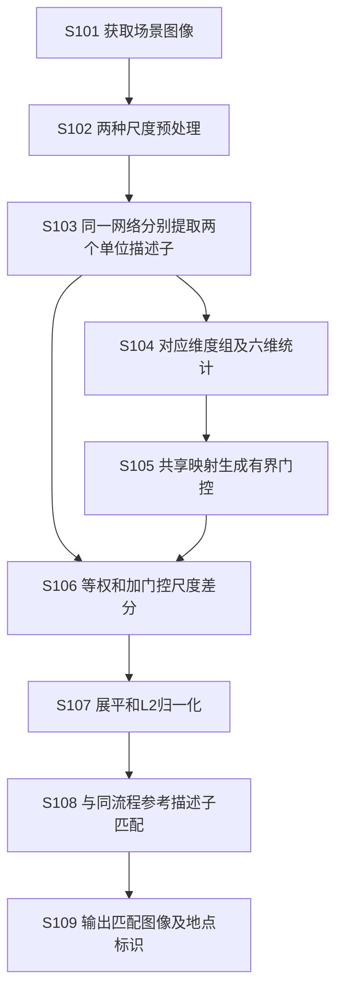
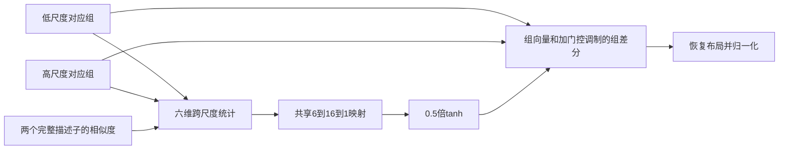
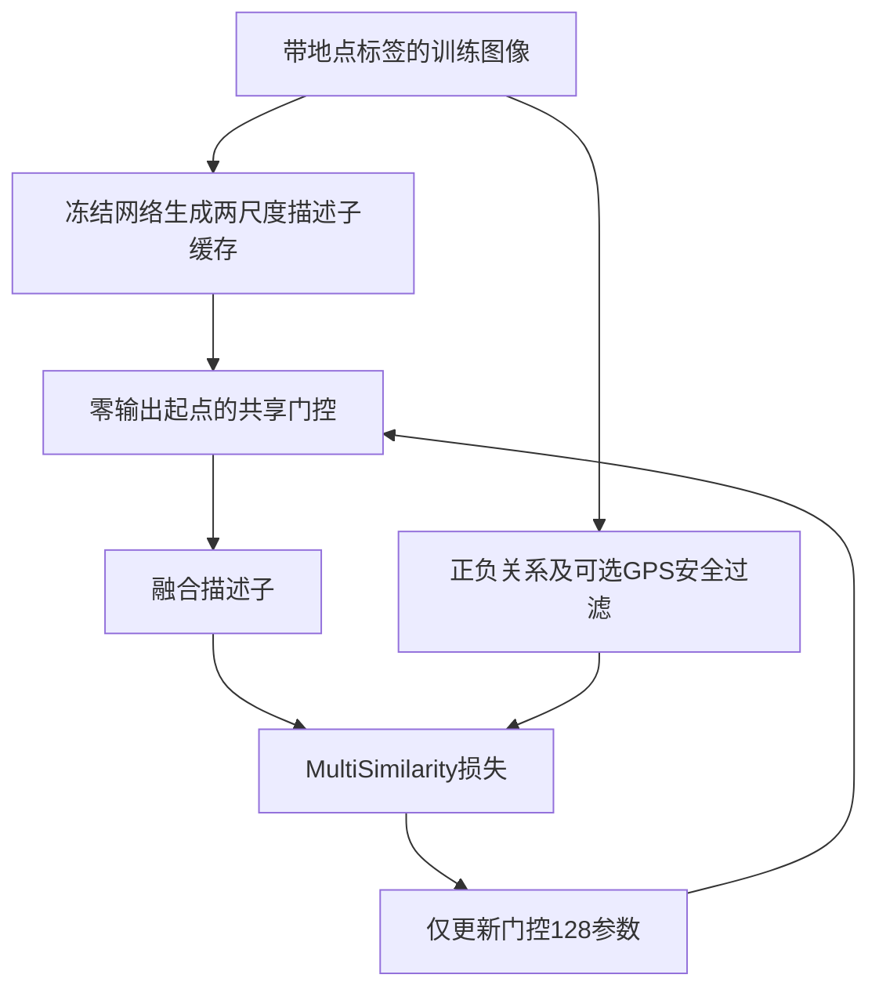

# 基于跨尺度一致性门控的视觉地点识别方法及装置

中文发明专利申请技术初稿V1，2026-10-26。供后续AI及专利代理师完善；未提交申请，未形成新颖性或创造性审查结论。公式和具体实施例依据已实现代码；有关范围概括及权利要求组织属于草拟建议。

申请人：________________

发明人：________________

申请人地址：________________

联系人及联系方式：________________

拟申请地区及优先权信息：________________

## 说明书摘要

本发明涉及计算机视觉与视觉地点识别，公开一种基于跨尺度一致性门控的视觉地点识别方法及装置。对同一场景图像进行两种尺度预处理，利用同一描述子提取网络获得两个归一化描述子，按相同布局形成对应维度组。根据组能量、跨尺度相似度、能量平衡、归一化差异及全图相似度构造组统计，经组间共享映射生成有界门控，将两描述子的等权和与门控调制的尺度差分融合，归一化为固定维数描述子。采用同一流程生成参考描述子并进行相似度检索。适配训练冻结描述子提取网络，以零输出门控起点训练新增映射参数。该方案可用于场景检索及视觉地点识别。

摘要附图：图1。

## 权利要求书

1. 一种基于跨尺度一致性门控的视觉地点识别方法，其特征在于，由计算设备执行，包括：

获取待识别的场景图像，将所述场景图像分别处理为第一输入尺度图像和第二输入尺度图像，所述第一输入尺度与第二输入尺度不同；

利用参数共享的同一描述子提取网络，分别从所述第一输入尺度图像和第二输入尺度图像获得第一归一化描述子和第二归一化描述子，所述两个描述子具有相同维数；

按相同的预设维度布局，将所述两个描述子分别组织成相同数量的维度组，使第一归一化描述子中的各维度组与第二归一化描述子中相同组索引的维度组对应；

针对各组索引，计算第一尺度组能量、第二尺度组能量、对应组的跨尺度余弦相似度、两尺度组能量的平衡量、对应组的归一化绝对差以及两个完整归一化描述子的相似度，组成六维跨尺度统计向量；

将各组的所述六维跨尺度统计向量输入组间共享的门控映射网络，并将门控映射网络的输出经双曲正切函数处理后乘以0.5，得到各组门控系数；

对各对应维度组，将第一尺度组向量与第二尺度组向量相加，并将第二尺度组向量减去第一尺度组向量得到的差分向量乘以该组门控系数后加至所述相加结果，获得融合组向量，将各融合组向量按所述预设维度布局恢复为融合描述子，并进行L2归一化；

将所得融合描述子与采用相同描述子提取网络、维度布局及已训练门控映射网络生成的参考图像融合描述子进行相似度匹配，输出匹配参考图像的标识及其关联地点信息。

2. 根据权利要求1所述的方法，其特征在于，设对应组向量为L_j和H_j，每组包含C个元素，组数为G，第一尺度组能量和第二尺度组能量分别为eL_j=Σc L_cj²和eH_j=Σc H_cj²，组内积为a_j=Σc L_cj H_cj；所述六维跨尺度统计向量依次包括：

log(max(G eL_j,ε))；log(max(G eH_j,ε))；a_j/max(√(eL_j eH_j),ε)；(eH_j−eL_j)/max(eL_j+eH_j,ε)；(Σc |H_cj−L_cj|/C)/max(√((eL_j+eH_j)/C),ε)；以及两个完整归一化描述子的内积，ε为正数。

3. 根据权利要求1所述的方法，其特征在于，所述两个归一化描述子的维数为12288，将其分别重排为384行和32列的矩阵，按列索引构成32个维度组，各维度组的门控系数沿384行广播，所述维度组由描述子输出维度布局确定。

4. 根据权利要求1所述的方法，其特征在于，所述门控映射网络包括依次连接的第一线性层、GELU激活层和第二线性层，第一线性层将六维统计映射为16维隐藏表示并具有偏置，第二线性层将所述隐藏表示映射为一个标量且不具有偏置，各维度组共用相同线性层参数，所述门控映射网络具有128个可训练参数。

5. 根据权利要求4所述的方法，其特征在于，所述门控映射网络通过以下适配训练获得：保持所述描述子提取网络的参数不变，将第二线性层的权重初始化为零，利用训练图像的两个尺度归一化描述子及地点标签，计算融合描述子的度量学习损失，仅更新门控映射网络参数；在训练起点，各组门控系数为零，所得融合描述子为两个尺度描述子之和的L2归一化结果。

6. 根据权利要求5所述的方法，其特征在于，所述适配训练预先缓存由冻结的描述子提取网络生成的两个尺度描述子，训练批次包括多个地点的图像，每一地点包含多个不同视角或采集时刻的图像，根据同地点标签建立正样本关系，根据异地点标签建立候选负样本关系，采用MultiSimilarity损失训练所述门控映射网络。

7. 根据权利要求6所述的方法，其特征在于，在训练图像具备地理坐标时，对由样本挖掘获得的异地点负样本对计算地理距离，在损失计算前排除地理距离小于25米的负样本对；所述地理坐标用于训练中的负样本过滤，不作为待识别图像推理时门控映射网络的必需输入。

8. 根据权利要求1所述的方法，其特征在于，所述组门控系数为g_j，融合组向量为：

\[
R_j=L_j+H_j+g_j(H_j-L_j),\qquad -0.5\leq g_j\leq0.5,
\]

所述融合组向量在整体L2归一化前，等价于以(1−g_j)/2及(1+g_j)/2分别混合两个尺度组向量后乘以统一系数2，所述两个混合系数均在0.25至0.75之间。

9. 根据权利要求1所述的方法，其特征在于，对参考图像预先计算所述融合描述子，并将其与参考图像标识及地点信息关联存储；对待识别图像独立生成融合描述子，以所述融合描述子与各参考融合描述子的内积作为相似度，按相似度排序输出地点识别结果；在生成待识别图像的门控系数时，不输入参考图像的中间特征。

10. 根据权利要求1所述的方法，其特征在于，所述第一输入尺度和第二输入尺度分别为322×322与518×518，采用整幅图像双三次插值缩放及相同通道标准化处理；所述描述子提取网络包括视觉Transformer编码器及利用可学习查询进行特征聚合的聚合网络，两个输入尺度使用相同的编码器参数和聚合网络参数。

11. 根据权利要求1所述的方法，其特征在于，在检测到门控系数或融合描述子包含非有限数值，或者融合描述子的L2范数低于预设阈值时，停止该次描述子生成或识别计算并输出异常信息，以避免对退化描述子进行检索。

12. 一种基于跨尺度一致性门控的视觉地点识别装置，其特征在于，包括：

图像获取与尺度处理模块，用于获取场景图像并生成两个不同输入尺度的图像；

共享描述子提取模块，用于利用同一套描述子提取网络参数分别生成两个尺度的归一化描述子；

维度组统计模块，用于按照相同维度布局组织对应组并生成六维跨尺度统计向量；

共享门控生成模块，用于将所述统计向量经组间共享映射及有界非线性处理，获得各维度组的门控系数；

差分融合与归一化模块，用于将两个尺度描述子的等权和与门控调制的尺度差分相加，生成归一化融合描述子；

地点匹配模块，用于与采用相同流程生成的参考融合描述子匹配，输出参考图像标识及关联地点信息；

所述各模块被配置为执行权利要求1所述的方法。

13. 一种电子设备，包括处理器及存储器，其特征在于，所述存储器存储有计算机程序，所述处理器执行所述计算机程序时，实现权利要求1至11中任一项所述的方法。

14. 一种非暂态计算机可读存储介质，其特征在于，存储有计算机程序，所述计算机程序被处理器执行时，实现权利要求1至11中任一项所述的方法。

## 说明书

### 技术领域

[0001] 本技术方案涉及计算机视觉、图像检索和视觉地点识别，尤其涉及在固定维数全局图像描述子上，利用跨尺度统计及有界门控进行融合，并与参考场景图像匹配的方法、装置、电子设备及存储介质。

### 背景技术

[0002] 视觉地点识别通过比较查询场景图像与参考场景图像的全局描述子，生成候选地点匹配结果，可作为视觉定位、地图检索或移动平台场景识别的组成部分。同一地点在拍摄尺度、视角及采集条件变化时，其图像描述子可能发生变化。

[0003] 对同一图像使用不同输入尺度，可以获得不同的描述信息。已有研究包含多分辨率表示、多尺度特征聚合以及描述子加权等处理方式。直接连接描述子会增加输出维数，简单求和或固定比例融合则预先规定各尺度的贡献。

[0004] 本方案关注以下具体技术任务：在保持最终检索描述子维数、保留两个完整尺度描述子的情况下，利用可计算的跨尺度统计生成受限的融合系数，并在固定图像描述子提取网络的条件下完成轻量适配。这里的轻量适配指新增可训练参数少，不表示两尺度编码没有额外计算开销。

### 发明内容

[0005] 为完成上述任务，本方案对同一图像分别生成两个尺度的单位描述子，将它们按相同输出布局组织为对应维度组，以六维统计驱动共享门控网络，并在等权融合路径上叠加门控调制的跨尺度差分，最终形成固定维数的单位描述子。

[0006] 所述统计同时包括组级能量、组级跨尺度相似度、相对能量变化、归一化幅值差异及全图跨尺度相似度。共享门控网络的输出经0.5倍双曲正切限制，使两个尺度在归一化前均保留至少0.25的等价混合系数。

[0007] 适配训练冻结原描述子提取网络，仅更新共享门控映射参数。末级线性映射零初始化，使训练起点精确对应两尺度描述子等权融合，便于从固定起点学习权重配置。

[0008] 参考图像与查询图像使用同一训练后的描述子提取网络和门控网络。两者分别独立生成融合描述子后，通过内积匹配输出参考图像标识及其关联地点信息。

### 可实现的技术效果

[0009] 在给定12288维输出的实施例中，融合后描述子仍为12288维，门控网络新增128个可训练参数；无需在门控适配时更新原编码器及聚合器参数。

[0010] 有界门控使两个尺度均参与融合，零输出起点与等权融合精确一致。上述结构特性来自公式与实现，不等同于保证归一化后描述子漂移或检索排序不变。

[0011] 在下述固定开发集实验中，整个两尺度门控模块相对322单尺度官方模型提高了R@1正确数，并能在另一冻结增强模型上继续提高部分数据集的R@1。该实验效果限定于所报告的检查点、数据及协议；本方案不据此声称逐组门控全面优于等权、全局或固定融合，也不声称全部场景必然提高。

### 附图说明

[0012] 图1示出从同图双尺度输入到全局描述子匹配的整体流程；图2示出六维组统计、共享映射及有界差分融合关系；图3示出冻结描述子提取网络、缓存生成与门控适配训练流程。

[0013] 图中组索引表示描述子输出维度的组织关系，不表示图像中的物理空间区域。

### 具体实施方式

#### 实施例一：双尺度描述子与分组

[0014] 获得RGB场景图像I，将其转为张量，分别双三次插值为322×322和518×518并启用抗混叠处理，再用通道均值(0.485,0.456,0.406)及标准差(0.229,0.224,0.225)标准化。

[0015] 两个输入使用同一套冻结的DINOv2-B14图像编码器与BoQ聚合参数，分别获得l和h，维数均为12288且各自已L2归一化。这里共享的是模型权重；同一图像仍执行两个尺度的前向计算。

[0016] 将批量描述子从(B,12288)重排为(B,384,32)。用从0开始的下标，L_cj=l_(32c+j)，H_cj=h_(32c+j)。对固定j沿384个通道取值形成一组，后续融合及展平保持这一布局。

#### 实施例二：跨尺度统计及门控

[0017] 计算各组能量eL_j、eH_j与组内积a_j，设ε=10^-8，计算：

\[
s_j=\left[\log\max(32eL_j,\varepsilon),\ \log\max(32eH_j,\varepsilon),\
\frac{a_j}{\max(\sqrt{eL_jeH_j},\varepsilon)},\
\frac{eH_j-eL_j}{\max(eL_j+eH_j,\varepsilon)},\
\frac{\sum_c|H_{cj}-L_{cj}|/384}{\max(\sqrt{(eL_j+eH_j)/384},\varepsilon)},\
l^\top h\right].
\]

[0018] 对全部32组使用同一映射：

\[
g_j=0.5\tanh\left(W_2\operatorname{GELU}(W_1s_j+b_1)\right),
\]

其中W1为16×6矩阵，b1为16维向量，W2为1×16矩阵且无输出偏置。总可训练参数为96+16+16=128。

[0019] 生成R_cj=L_cj+H_cj+g_j(H_cj−L_cj)，将R展平并L2归一化为z。g_j在该组全部384个通道上广播，不对各通道独立生成128套参数，也不根据人工语义类别进行剔除。

[0020] 代码在发现非有限值或原始融合向量范数低于10^-8时报告异常并停止该次计算。正常输入得到的z用于后续全局相似度检索。

#### 实施例三：冻结网络的门控适配训练

[0021] 选用8192个训练地点，每地点固定4幅训练图像，共32768幅，地点标签用于正负关系构建。由冻结网络预先分别提取并缓存每图两个尺度的FP32描述子，核对图像内容摘要与索引顺序。

[0022] 固定三个重复种子43、44和45，各自随机初始化第一线性层及其偏置，并将第二线性层W2置零。两个尺度的描述子提取网络保持冻结，优化器只接收128个门控参数。

[0023] 每批选择16地点、每地点4图，共64图。对每轮8192地点按固定种子置换，两轮共1024步。正式训练前进行8步检查并丢弃检查产生的权重，从原始初值重新开始正式训练。

[0024] 使用MultiSimilarityMiner挖掘样本对，epsilon取0.1；当训练图像具有地理坐标时，按Haversine距离过滤挖掘负对中距离小于25米的异地点图像对，再计算MultiSimilarity损失，alpha=1、beta=50、base=0。使用AdamW，学习率0.001、weight_decay=0、梯度范数裁剪1，固定训练1024步。训练标签及地理坐标不作为查询推理输入。

[0025] 训练完成后保存固定最终门控权重，参考图与查询图均使用这些权重。主实施路径不包含跨视角教师MSE、验证集比例搜索或在线门控更新。

#### 实施例四：参考库与地点匹配

[0026] 对每幅参考场景图像执行实施例一和二，将所得融合描述子与参考图像标识及地点信息存储在参考描述子集合中。

[0027] 对查询场景图像执行相同处理，计算查询融合描述子与各参考融合描述子的内积并排序。可输出最高相似度参考图像的地点标识，或者输出前K个候选参考图像；本实验K=20。

[0028] 参考及查询使用一致的模型、布局、尺度和门控版本。若描述子提取网络或门控权重改变，应使用对应版本重新计算参考描述子以保持匹配一致性。此过程不直接估计经验证的米级定位误差或六自由度位姿。

#### 实施例五：已有增强描述子模型上的组合

[0029] 描述子提取网络也可以是预先训练完成并冻结的增强视觉地点识别模型。只要该模型对两个尺度输出相同维数和固定对应布局的单位描述子，仍可按实施例二至四处理。本实施例使用项目中既有冻结增强模型；本初稿不将其内部适配结构作为本次门控方法的必需组成。

[0030] 两种模型族分别完成相同预算的门控适配，使用相同门控随机初值及训练图像日程。已完成的增强模型训练及门控实验经摘要和完整预测核对后复用，没有为组合实验重新训练或更改原增强模型。

#### 实施例六：实验结果及效果限定

[0031] 在GSV适配阶段保留集、MSLS验证集与Pitts验证集上进行检索，查询数分别为3072、740及7608。两个模型族使用相同的参考与查询人口、图像内容、GT和检索协议；所有数据均为开发中反复使用的人口，不表述为独立盲测。

[0032] 六组R@1正确数为下表。Pitts三值依次对应43、44、45号门控种子，单值表示三个种子相同：

|配置|GSV /3072|MSLS /740|Pitts /7608|
|---|---:|---:|---|
|官方322|3048|694|7264|
|官方双尺度等权|3051|694|7294|
|官方双尺度逐组门控|3052|695|7294/7293/7294|
|增强模型322|3049|695|7276|
|增强模型双尺度等权|3051|696|7287|
|增强模型双尺度逐组门控|3051|695|7288/7290/7290|

[0033] 相对官方322，整个双尺度门控模块在Pitts净增加30、29、30条正确查询，均值约+0.38994个百分点；相对增强模型322，在Pitts增加12、14、14条，均值约+0.17525个百分点。上述“百分点”不是相对百分比，也不表示30个百分点。

[0034] 官方双尺度等权在Pitts已达到7294，因此逐组门控在该数据集相对等权融合为持平、少1条、持平。在官方模型上，整图门控、训练平均门控及同权重打乱门控与逐组候选的R@1正误集合一致；这些结果不支持把整体增益全部归因于逐组自适应。组合模型的Pitts R@1也未超过官方双尺度门控，故不主张两个模块已证明相互增强。

[0035] Pitts的官方逐组门控相对官方等权融合，在R@5每种子增加4条，R@10持平，R@20每种子少1条；全局及固定平均等对照也达到同样计数。上述实验用于说明具体实施的效果和取舍，不保证所有检索层级或应用条件均有改善。

[0036] 三种子重复只改变门控头初值及批次顺序，编码器保持固定。已保存的162份版本结果按原GT重算四层召回、纠错/退化ID及主要查询区间，并核验模型状态和缓存封存。没有报告未经测量的实际部署帧率、能耗、动态类别剔除效果或闭环导航指标。

### 装置、电子设备及介质实施方式

[0037] 计算设备中的处理器执行图像预处理、描述子提取、组统计、门控、融合和检索程序；存储器保存模型参数、参考描述子及图像/地点标识关联关系。图像可由文件、图像数据库或图像采集设备提供，机器人或车辆为可选应用载体，不是已完成实车验证的声明。

[0038] 所述程序可存储于非暂态计算机可读存储介质，由处理器读取执行。各功能模块可以由软件指令在计算设备上实现，不限定为已经制造的专用芯片。

## 附图逻辑稿

以下为技术逻辑图；后续撰写者应根据这些连接关系制作正式黑白专利附图，核对步骤编号及标号。图中文字不构成新实验数据。

### 图1：整体识别流程

### 图2：组门控与融合

### 图3：门控适配训练

## 供后续撰写者使用的说明

本文件不是请求书电子表单或提交版。申请人、真实发明人、权属、优先权与首次公开时间由申请人补充；现有技术比较及保护范围需要另行审阅，见[SCALE_GATE_PRIOR_ART_NOTES_V1.md](SCALE_GATE_PRIOR_ART_NOTES_V1.md)。可复现的源码、摘要和证据路径在[技术交底](SCALE_GATE_TECHNICAL_DISCLOSURE_V1.md)及[AI交接](SCALE_GATE_AI_HANDOFF_V1.md)。原始源码与完整结果优先于本初稿的叙述。
