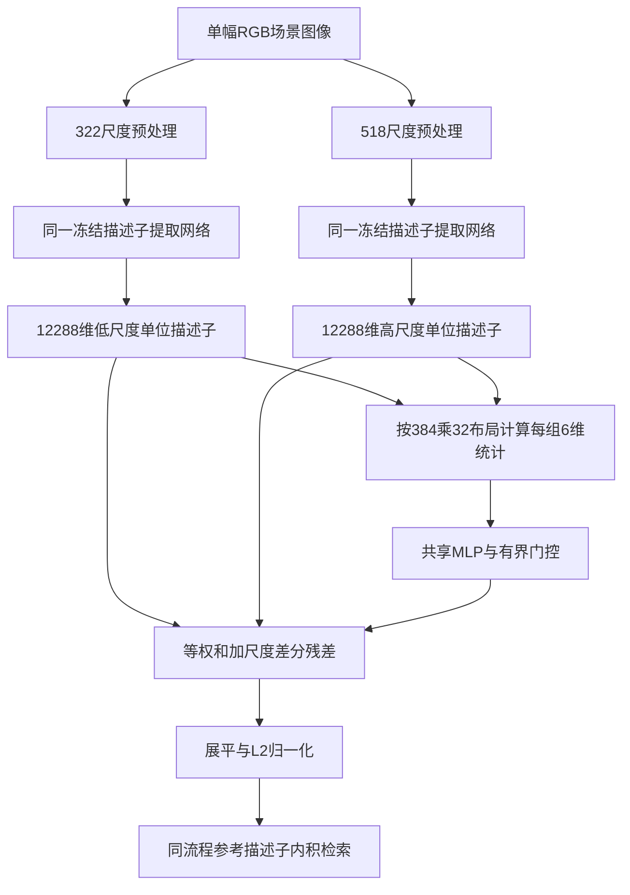

# 跨尺度一致性有界门控：技术交底与实现记录V1

编制日期：2026-10-26。用途：第二技术模块的专利撰写、源码核对及向下一位AI交接。本文记录已实现版本，不表示专利已获授权或完成新颖性评价。

阅读入口：[申请初稿](SCALE_GATE_PATENT_DRAFT_V1.md)、[AI交接](SCALE_GATE_AI_HANDOFF_V1.md)、[公开参考与待核查事项](SCALE_GATE_PRIOR_ART_NOTES_V1.md)。最新完整实验依据为[SCALE_FACTORIAL_V1_RESULT.md](SCALE_FACTORIAL_V1_RESULT.md)。

## 1. 方案身份与结论

拟用名称：**基于跨尺度一致性门控的视觉地点识别方法及装置**。

准确的技术对象是：对同一幅图像的两个完整、归一化全局描述子，在固定维度组布局上计算六维跨尺度统计，用组间共享的小型网络生成有界系数，以“等权和＋跨尺度差分残差”形成最终检索描述子。主干及聚合器冻结，仅适配门控网络。

该模块可以独立接在官方VPR模型后，也可以接在已有增强描述子模型后。当前实验证明整个模块在固定开发人口上有可重复的观察收益。逐组自适应相对全局、固定、打乱门控的额外价值仍弱，不能将整个模块的收益全部归到该细粒度机制。两点组合的R@1也没有超过独立第二模块。以下保留这些边界。

### 版本界限

|版本|身份|本交底中的地位|
|---|---|---|
|scale_agreement_fusion_v1|原128参数ScaleAgreementFusion，单头种子42|结构来源；历史结果|
|scale_agreement_repeat_v1|同结构43/44/45号，改变头初值及训练顺序|已有增强模型上的重复证据|
|scale_factorial_v1|同结构，两模型族六格消融|当前主要实验依据|
|scale_reliability_gate_v1|中心化门控及跨视角教师MSE|另一失败改版，**不作为当前方案**|
|既往CLIP/语义/动态抑制方案|语义类别或掩码干预|不属于当前方案；当前门控不使用CLIP、分割、动态标签|

第一技术模块保持封存。不能把旧专利初稿doc/patent_drafts/vpr_conv_residual_20261013的卷积特征残差公式直接替换到本模块中：本模块作用在聚合后的描述子上，残差基准、边界和前向次数都不同。

## 2. 输入、输出与数据流

输入：单幅RGB场景图像I。对查询图和每张参考图均独立执行同一流程。

1. 对I分别进行整图方形缩放，得到322×322与518×518输入；先ToTensor，再bicubic Resize、antialias=True，再按ImageNet均值(0.485,0.456,0.406)、标准差(0.229,0.224,0.225)标准化。
2. 使用同一套冻结网络E分别前向两次。E包括图像编码器与完整描述子聚合器；官方实施为DINOv2-B14＋BoQ，增强实施为已有冻结增强模型。得到l,h∈R^12288，二者已分别L2归一化。
3. 将每个描述子按原输出布局reshape为C×G，其中C=384、G=32。
4. 为每个组j计算六维统计s_j，输入组间共享的MLP。
5. 获得每图每组一个门控g_j，广播到该组384个通道，在对应尺度组之间融合。
6. 按原布局展平并L2归一化，得到z∈R^12288。
7. 与同流程生成的参考描述子做内积相似度检索。本评测实现保存参考图像索引Top20，R@1/5/10/20用于评测；应用层可将匹配索引按参考元数据映射为地点标识，当前没有实车部署接口验证。

不把查询和参考图中间特征联合输入门控；不依据参考库或真实查询标签在线选择尺度；不输出经实测证明的米级坐标或六自由度位姿。已有参考元数据可将参考图像标识映射到地点信息。



## 3. 精确布局与六维统计

批量实现：low/high形状(B,12288)，内部L/H形状(B,384,32)。用从0开始的下标，L[c,j]=l[cG+j]。**不是reshape(B,32,384)后将连续384维当一组。** 最终输出仍按同一布局flatten。

这些组是最终全连接输出的代数组。它们不等于图像空间区域，不等于原BoQ的64个learnable queries，不表示已验证的建筑/道路/车辆区域或物理地标。

设ε=10^-8，组j的384维向量为L_j,H_j：

\[
e^L_j=\sum_c L_{cj}^2,\quad e^H_j=\sum_c H_{cj}^2,\quad a_j=\sum_c L_{cj}H_{cj}.
\]

六维统计严格对应src/models/scale_agreement_fusion.py的agreement_features：

\[
s_j=\left[
\log\max(Ge^L_j,\varepsilon),\quad
\log\max(Ge^H_j,\varepsilon),\quad
\frac{a_j}{\max(\sqrt{e^L_je^H_j},\varepsilon)},\quad
\frac{e^H_j-e^L_j}{\max(e^L_j+e^H_j,\varepsilon)},\quad
\frac{C^{-1}\sum_c|H_{cj}-L_{cj}|}{\max(\sqrt{(e^L_j+e^H_j)/C},\varepsilon)},\quad
\gamma
\right],\qquad \gamma=\sum_j a_j=l^\top h.
\]

前五个量依组而变，第六个全图一致性量复制到每组。能量越大不直接等于可靠性，门控系数也不是概率。MLP只看六维摘要，没有直接学习投影每组384维内容向量。

## 4. 门控网络、融合和初始化

\[
u_j=W_2\operatorname{GELU}(W_1s_j+b_1),\qquad g_j=0.5\tanh(u_j).
\]

W1形状16×6，b1形状16，W2形状1×16且无输出bias。总参数6×16+16+16=128，所有32组共享同一套参数；不是每组128参数。

融合：

\[
R_{cj}=L_{cj}+H_{cj}+g_j(H_{cj}-L_{cj}),\quad
z=\frac{\operatorname{vec}(R)}{\|\operatorname{vec}(R)\|_2}.
\]

等价的归一化前凸混合系数为αL_j=(1−g_j)/2、αH_j=(1+g_j)/2，每个均在[0.25,0.75]内，两者和为1；上述R相当于该混合的2倍，最终L2归一化消去统一比例。

初始化将W2全部置零，W1/b1沿用固定随机种子下nn.Linear初始化。因此g=0，起点**精确等于normalize(l+h)**。它不等于322单尺度描述子，不保证增强模型原输出完全不变。

当l=h时，融合输出等于该单位描述子。代码mix拒绝非有限系数、绝对值超过0.500001的系数、非有限原始融合量或范数<10^-8的退化融合；没有实现出现退化后自动切换分支的策略。

限制的是混合系数。不能改写成“最终描述子距离变化不超过某百分比”或“排名不变”。实际非零门控会改变排序。

### 与代码等价的主路径

```python
# E自身输出单位向量，不在缓存读入后额外投影或再次归一化单分支。
low, high = E(T322(image)), E(T518(image))
L, H = low.reshape(B, 384, 32), high.reshape(B, 384, 32)
s = agreement_features(L, H)               # B,32,6
g = 0.5 * torch.tanh(up(F.gelu(down(s)))).squeeze(-1)
raw = (L + H + g[:, None, :] * (H-L)).flatten(1)
z = F.normalize(raw, dim=1)
```

此伪代码省略文件/数值检查，训练复现应调用原实现，不用人工改写替代已封存代码。两个前向共用权重，但仍有两个尺度的编码计算；128是新增可训练参数，不是总模型参数或零额外算力。

## 5. 训练与参考库生成

|项|已验证设置|
|---|---|
|训练数据|GSV固定8192地点，每地点4图，共32768图|
|批次|16地点×4图=64图；缓存编码FP32微批2|
|随机性|头初值与批次顺序用43/44/45；固定已有编码器权重|
|日程|两轮，每轮512步，共1024步；每轮default_rng(1000×seed+epoch)置换8192地点|
|优化|AdamW，lr=0.001，weight_decay=0，梯度范数裁剪1|
|目标|GPS安全负对过滤后的MultiSimilarity，alpha=1、beta=50、base=0；MultiSimilarityMiner epsilon=0.1|
|坐标使用|对已经挖掘的异地点负对剔除地理距离<25m者；仅训练使用GPS|
|参数冻结|完整编码器、聚合器及已有增强模块冻结，只优化128参数门控|
|起点与检查|每种子8步实际缓存smoke后丢弃并重新初始化；固定最后1024步，不挑最好checkpoint|
|部署|同一已训练门控同时用于参考图与查询图，参考向量可预先计算并关联图像/地点标识|

训练先生成两尺度冻结描述子缓存，之后优化只读取缓存；不用梯度更新主干。监督标签用于构建正负对，不输入推理门控。模型更新后需要保持参考描述子与查询描述子使用一致的网络及门控版本；旧参考向量不能假设自动兼容。

## 6. 主要实验数据与效果

三个开发人口：GSV参考1024＋查询3072；MSLS参考18871＋查询740；Pitts参考10000＋查询7608。图像顺序、内容摘要和GT在两模型族间匹配。GSV是适配阶段holdout，不宣称与基础模型原训练数据绝对无交集；全部三套数据已多次开发曝光。

R@1正确数如下，斜线顺序43/44/45；单值表示各种子相同。

|格|配置|GSV /3072|MSLS /740|Pitts /7608|
|---|---|---:|---:|---|
|A|官方322|3048|694|7264|
|B|官方双尺度等权|3051|694|7294|
|C|官方双尺度逐组门控|3052|695|7294/7293/7294|
|D|已有增强模型322|3049|695|7276|
|E|已有增强模型双尺度等权|3051|696|7287|
|F|已有增强模型双尺度逐组门控|3051|695|7288/7290/7290|

- C−A：GSV+4，MSLS+1，Pitts+30/+29/+30，Pitts平均约+0.38994个百分点。
- F−D：GSV+2，MSLS计数持平，Pitts+12/+14/+14，平均约+0.17525个百分点。
- C−B：GSV+1，MSLS+1，Pitts0/-1/0；不能说逐组门控全面超过等权融合。
- F−E：GSV0，MSLS-1，Pitts+1/+3/+3。
- F−C：GSV-1，MSLS计数0，Pitts-6/-3/-4；不能说组合达到最佳或两个模块互相增强。

在官方模型上，逐组门控与整图条件门控、训练打乱、训练平均门控、同权重推理打乱在三种子×三数据集的R@1正误集合完全相同。官方Pitts的C相对等权B为8纠错/8退化、8/9、8/8。训练平均系数也达到同样R@1，因此当前不能主张逐图逐组对应是观察收益的必要原因。

Pitts四层正确数：

|配置|R@1|R@5|R@10|R@20|
|---|---|---:|---:|---:|
|A|7264|7546|7582|7599|
|B|7294|7554|7588|7600|
|C|7294/7293/7294|7558|7588|7599|
|D|7276|7550|7583|7599|
|E|7287|7555|7587|7598|
|F|7288/7290/7290|7558|7589|7598|

C比B的R@5每次多4，R@20每次少1；全局/平均/打乱控制也达到C的这些计数。完整其他召回与对照见原结果，不能只选有利层级。

### 不确定性与核验

Pitts的C−A平均+0.38994个百分点，95%查询bootstrap[+0.14020,+0.64406]；C−B为-0.00438，区间[-0.10953,+0.10077]；F−D为+0.17525，区间[-0.07021,+0.43824]；F−E为+0.03067，区间[-0.09201,+0.15346]。固定2000次，先按查询平均种子差再抽样，不把相同查询当三倍独立样本。Pitts共享GT分量只有3个、最大82.02%，依赖敏感性区间不满足充分性要求。统计结果不作为专利授权结论。

18项服务器测试通过；全部smoke/训练/缓存/评测机械检查通过；162份版本×种子×数据集的Top20按原GT独立重算，主要区间及交互项直接重抽复算通过。报告包136文件摘要匹配。未重训增强模型、未访问新盲测、未做部署时延/能耗或真实机器人闭环定位实验。

## 7. 代码与证据入口

所有下列相对路径均相对于项目根目录；本机C:/Users/zy/Desktop/MyVPR，训练机/home/wt/workspace/OpenVPRLab。

|路径与符号|用途|
|---|---|
|[src/models/scale_agreement_fusion.py](../../../src/models/scale_agreement_fusion.py):15 agreement_features|六维统计及ε|
|同文件:30 mix、:44 ScaleAgreementFusion|精确布局、边界、网络及初始化|
|[src/models/official_boq.py](../../../src/models/official_boq.py):66 load_official|离线加载作者网络/权重；全部张量校验|
|[scripts/cross_resolution_detail.py](../../../scripts/cross_resolution_detail.py):73 ScaleImages|同图322/518及图像SHA核对|
|[scripts/semantic_region_study.py](../../../scripts/semantic_region_study.py) transform|方形bicubic与ImageNet标准化|
|[scripts/scale_agreement_repeat.py](../../../scripts/scale_agreement_repeat.py):49 training_schedule、:102 train_seed|三种子训练原算法；优化器/随机状态/均值门控标定|
|[scripts/spatial_resample.py](../../../scripts/spatial_resample.py):84 mined_loss|已挖掘负对GPS过滤|
|[src/losses/vpr_losses.py](../../../src/losses/vpr_losses.py):26 VPRLossFunction|MS损失及miner参数|
|[scripts/scale_factorial.py](../../../scripts/scale_factorial.py):124 official、:184 cache、:257 private_trainer、:286 evaluate、:386 aggregate|原模型双尺度缓存、私有命名空间复用训练器、六格评测|
|[scripts/launch_scale_factorial.py](../../../scripts/launch_scale_factorial.py)|有限流水线，完成后不自动扩大实验|
|[config/scale_factorial.json](../../../config/scale_factorial.json)|冻结超参|
|[src/scale_factorial_statistics.py](../../../src/scale_factorial_statistics.py)|六格效应与交互|
|[src/scale_repeat_statistics.py](../../../src/scale_repeat_statistics.py)|配对查询及共享GT分量bootstrap|
|[scripts/audit_scale_factorial.py](../../../scripts/audit_scale_factorial.py)|独立CPU核验及报告快照|
|[tests/test_scale_agreement_fusion.py](../../../tests/test_scale_agreement_fusion.py)、[tests/test_scale_factorial.py](../../../tests/test_scale_factorial.py)|零起点、布局、控制、梯度恢复、六格统计及命名空间测试|

原训练源码未修改。六格脚本在私有Python模块实例中重绑定输出/contract/封存函数，复用原train_seed；不修改原模块全局状态，不覆盖旧运行。

### 运行产物位置

|内容|训练服务器位置|本机轻量副本|
|---|---|---|
|六格最终报告|logs/scale_factorial_v1/aggregate/summary.json|doc/scale_factorial_v1_server/aggregate/summary.json|
|独立核验|logs/scale_factorial_v1/independent_audit/summary.json|同轻量根目录independent_audit/summary.json|
|两模型族逐查询结果|logs/scale_factorial_v1/{official或innovation1}/seed{43,44,45}/eval/{dataset}.json|同相对结构|
|官方训练头/优化器/随机状态|logs/scale_factorial_v1/seed{43,44,45}/train/last.pt|未下载，不在交接包|
|增强模型训练头|logs/scale_agreement_repeat_v1/seed{43,44,45}/train/last.pt|未下载|
|官方两尺度缓存|.cache/scale_factorial_v1/{train_official及eval_*}|仅contract/summary/completed元数据|
|增强模型低尺度训练缓存|.cache/relation_metric_v1/train|未下载|
|增强模型高尺度/评测缓存|.cache/scale_agreement_fusion_v1|未下载|
|增强模型原权重|logs/conditional_complement_v1/train_c_cross_condition/last.pt|未下载|

不把本机报告目录中的completed.json引用服务器checkpoint但本机不存在，误判为服务器缺失。交接包不足以从零训练，完整训练还需要既有数据、模型权重、依赖和上述缓存。

### 固定身份

- 核心门控代码LF规范化SHA256：3f718437c1eda74d70cf61e56000bacebb24cbb7ae0419f2c88c5fb359dd6799，与六格contract一致。
- 官方作者仓库固定提交：1a4965ea7dfd9bd0dd846adf7a0e430f68101d12；作者权重文件SHA256：d72ee0ce899e2790be6cf6d1d57f75dfad0c76475bd2198e6dc0c3f0221b3583。
- 官方模型完整状态摘要：65b2f12e991fc16e42201d9e1bba3976885b0424a494e87293e46e697c8e1aa6。
- 增强模型完整状态摘要：85efdb822f8a805e5ba69dca0a27521c09954ce9cdee18e1c8cbc30d8212eee6；其checkpoint文件SHA256：ba8b477c30534bbde34976cad7fa77b95c2711a49ddee3802c7b7019702420aa。
- 六格源码本地提交96c4c22，结果审计与文档提交c03ede6。
- 136文件报告归档SHA256：f6d6c486005f0a52d4fd2d17f047a779a216d34923b269c8eec7b0c6fea0bc50。

文件摘要、模型张量状态摘要、参数摘要和Git提交ID是不同对象，不能互换。逐种子完整头摘要保存在independent_audit/summary.json及交接包evidence.json，不指定验证最好种子作为唯一实施例。

## 8. 复查命令与撰写边界

以下命令在既有训练服务器执行，本次撰写不运行新训练：

```bash
cd /home/wt/workspace/OpenVPRLab
cat logs/scale_factorial_v1/aggregate/summary.json
CUDA_VISIBLE_DEVICES='' OMP_NUM_THREADS=4 /home/wt/.conda/envs/VPR/bin/python scripts/audit_scale_factorial.py
# 已完成的原启动器仅用于了解复现入口；不会自动重训已封存结果。
/home/wt/.conda/envs/VPR/bin/python scripts/launch_scale_factorial.py --allow-training
```

专利撰写可围绕具体统计组合、共享小网络、有界差分融合、零起点及冻结训练的技术组合展开；“多尺度”“加权融合”“门控网络”各自不是本项目已证明首次提出的概念。新增范围如三尺度、CLIP、空间动态抑制、在线自适应、端到端更新骨干均不能写成已实现或已验证的当前实施例。
